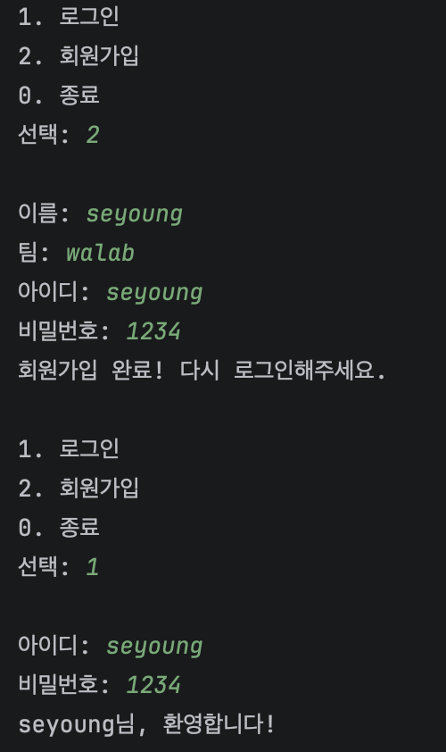
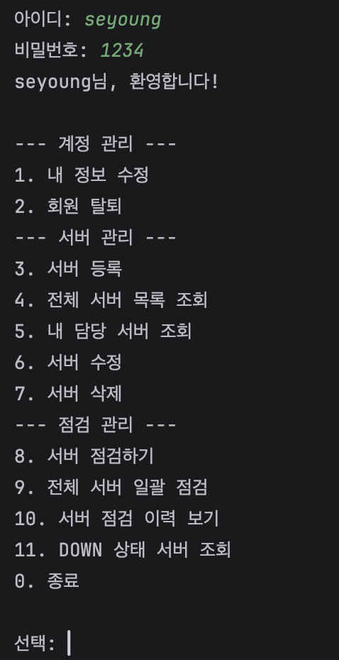
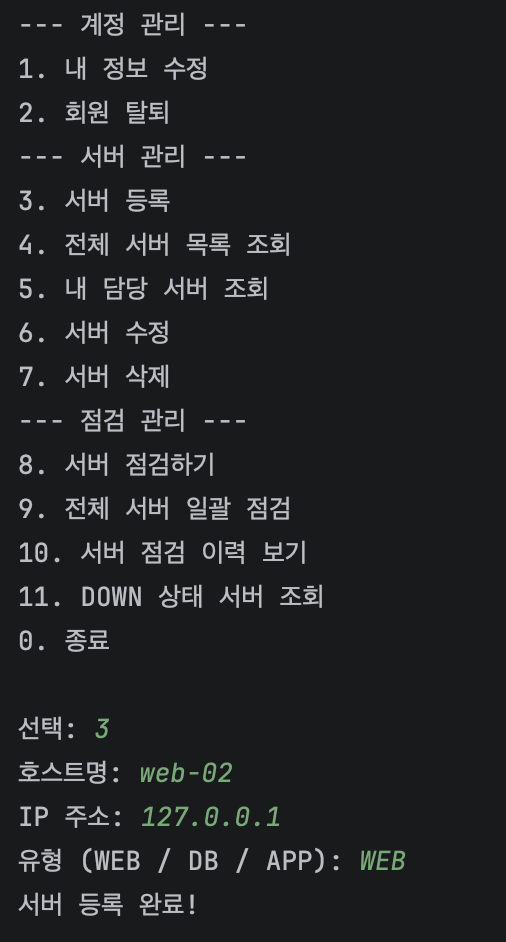
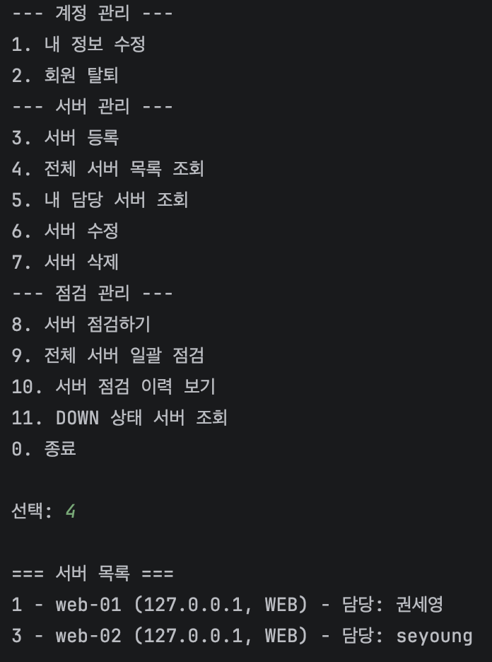
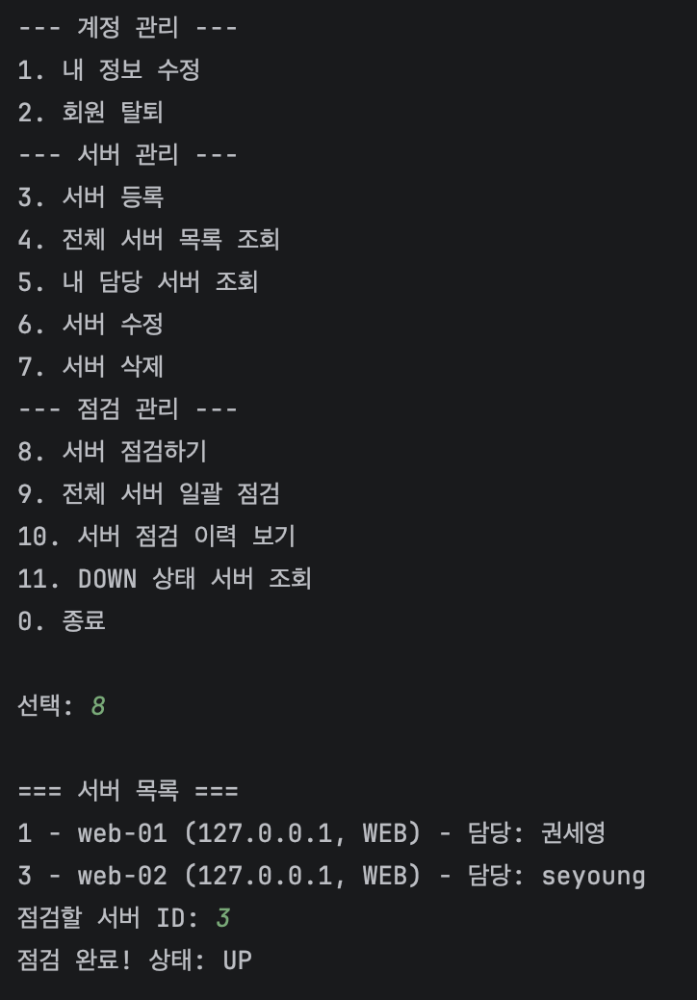
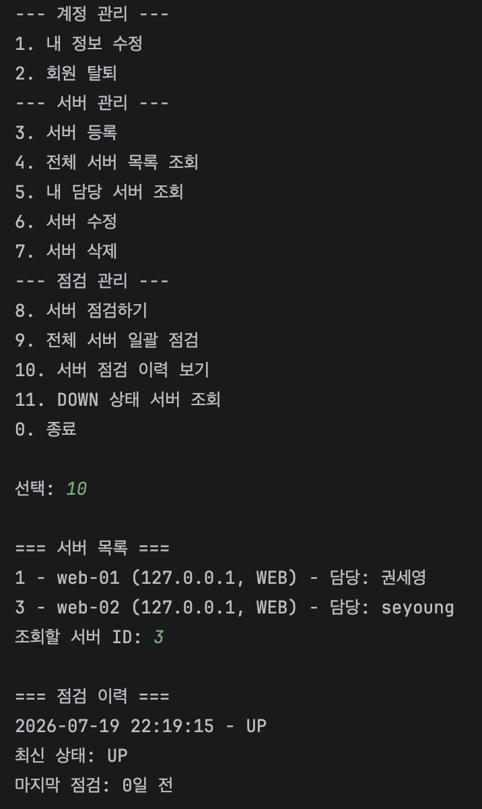
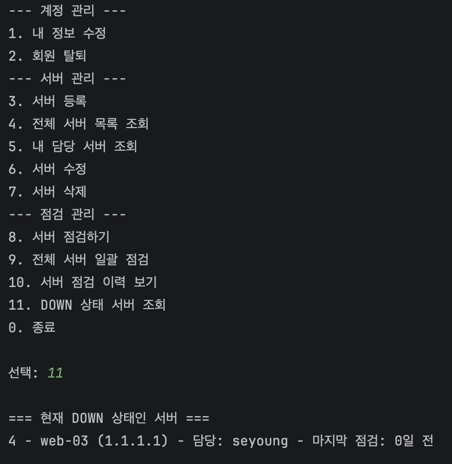
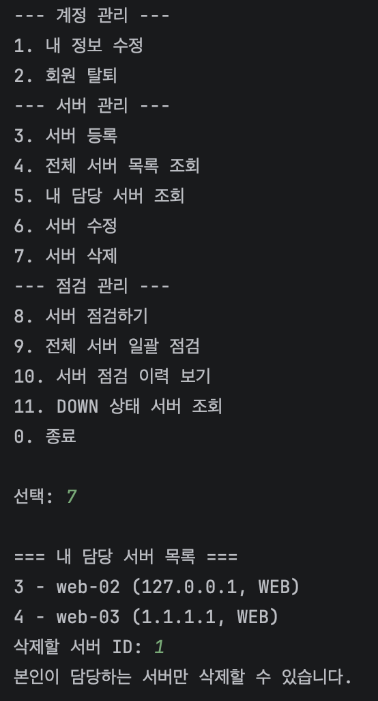

# server-inventory

인프라/클라우드 엔지니어를 목표로 하며, 회사에서 쓰는 CMDB를 축소해서
만들어본 서버 인벤토리 관리 프로그램입니다.

여러 팀원이 나눠 담당하는 서버 자산을 등록하고, 점검 이력을 기록/추적하여 방치된 서버를 찾아낼 수 있는
"감사 도구"를 목표로 설계했습니다.

## 목차

- 주요 기능
- 사용 기술
- 프로젝트 구조
- 실행 방법
- DB 테이블 구조
- 실행 예시
- Git Branch 전략
- 왜 인터페이스 기반으로 설계했는가
- 개발 중 어려웠던 점과 해결 방법
- 향후 개선 방향

## 주요 기능

**인증**

- 회원가입 / 로그인 (아이디·비밀번호 기반)

**계정 관리**

- 내 정보 수정
- 회원 탈퇴

**서버 관리**

- 서버 등록
- 전체 서버 목록 조회
- 내 담당 서버 조회
- 서버 수정 / 삭제

**점검 관리**

- 실제 IP에 핑(ping)을 쏴서 서버 상태(UP/DOWN)를 확인하고 기록
- 전체 서버 일괄 점검
- 서버별 점검 이력 조회 (마지막 점검 이후 경과일 표시)
- 현재 DOWN 상태인 서버만 모아서 조회

## 사용 기술

- Language: Java 21
- Build Tool: Maven
- Database: MariaDB (Docker)
- JDBC Driver: mariadb-java-client 3.5.7
- Container: Docker, Docker Compose
- IDE: IntelliJ IDEA

## 프로젝트 구조

    server-inventory
    ├── pom.xml
    ├── docker-compose.yml
    ├── schema.sql
    └── src
        └── main
            ├── java
            │   └── com.example.serverinventory
            │       ├── Main.java
            │       ├── model
            │       │   ├── User.java (id, name, team, username, password)
            │       │   ├── Server.java
            │       │   └── ServerCheck.java
            │       ├── repository
            │       │   ├── UserRepository.java / ServerRepository.java / ServerCheckRepository.java  (interface)
            │       │   ├── User/Server/ServerCheckMemoryRepository.java  (메모리 기반 구현체)
            │       │   ├── User/Server/ServerCheckFileRepository.java   (파일 기반 구현체)
            │       │   └── User/Server/ServerCheckDbRepository.java     (DB 기반 구현체)
            │       ├── service
            │       │   └── UserService.java / ServerService.java / ServerCheckService.java
            │       ├── util
            │       │   └── DBConnection.java
            │       └── view
            │           └── ConsoleView.java
            └── resources
                └── db.properties

## 실행 방법

1. 저장소 클론 및 db.properties 설정

       cp src/main/resources/db.properties.example src/main/resources/db.properties

2. Docker로 MariaDB 실행

       docker compose up -d

3. 스키마 적용

       docker exec -i java-crud-mariadb mariadb -u user -ppassword crud_db < schema.sql

4. Repository 버전 선택 (Main.java)

       // 메모리 버전
       UserRepository userRepository = new UserMemoryRepository();

       // 파일 버전
       UserRepository userRepository = new UserFileRepository();

       // DB 버전 (기본값)
       UserRepository userRepository = new UserDbRepository();

5. 실행

   IntelliJ에서 Main.java 실행, 또는:

       mvn compile exec:java -Dexec.mainClass="com.example.serverinventory.Main"

   최초 실행 시 "2. 회원가입"으로 계정을 먼저 만든 뒤, "1. 로그인"으로 들어가야 합니다.

## DB 테이블 구조

    CREATE TABLE user (
        id       BIGINT AUTO_INCREMENT PRIMARY KEY,
        name     VARCHAR(50) NOT NULL,
        team     VARCHAR(50),
        username VARCHAR(50) NOT NULL UNIQUE,
        password VARCHAR(100) NOT NULL
    );

    CREATE TABLE server (
        id          BIGINT AUTO_INCREMENT PRIMARY KEY,
        hostname    VARCHAR(100) NOT NULL,
        ip_address  VARCHAR(50),
        type        VARCHAR(20),
        owner_id    BIGINT,
        FOREIGN KEY (owner_id) REFERENCES user(id)
    );

    CREATE TABLE server_check (
        id         BIGINT AUTO_INCREMENT PRIMARY KEY,
        server_id  BIGINT NOT NULL,
        checked_at DATETIME NOT NULL,
        status     VARCHAR(10),
        FOREIGN KEY (server_id) REFERENCES server(id) ON DELETE CASCADE
    );

user 1:N server 1:N server_check 구조로, 마스터 데이터(User)와 사용자별 데이터(Server), 이력 데이터(ServerCheck)를
레이어로 분리했습니다. username에는 UNIQUE 제약을, server_check의 FK에는 ON DELETE CASCADE를 걸어
서버 삭제 시 관련 점검 기록도 함께 정리되도록 했습니다.

## 실행 예시

**회원가입**

**로그인 성공**

**서버 등록**

**전체 서버 목록 조회 (담당자 표시)**

**서버 점검**

**점검 이력 및 경과일 조회**

**DOWN 상태 서버 조회**

**본인 소유 아닌 서버 수정/삭제 시도 시 거부**

## Git Branch 전략

이번 프로젝트는 별도의 develop/feature 브랜치 없이 main 브랜치 하나에서 진행했습니다.
대신 기능 단위로 커밋을 나누어 작업 이력을 관리했습니다.

    feat: User/Server/ServerCheck 모델 및 Repository 인터페이스, 메모리 구현체 작성
    feat: UserService 구현 (등록/조회/수정/삭제)
    feat: File 기반 Repository 3종 구현 및 Main 연결
    feat: Docker MariaDB 연동 및 DBConnection Singleton 구현
    feat: UserDbRepository 구현 (JDBC, PreparedStatement) 및 DB 저장 확인
    feat: 로그인/회원가입 기능 구현 및 담당 서버 자동 필터링 적용
    fix: server_check FK에 ON DELETE CASCADE 추가

향후 여러 기능을 병행 개발해야 하는 프로젝트에서는 develop/feature 브랜치 전략을
적용해볼 계획입니다.

## 왜 인터페이스 기반으로 설계했는가

Repository를 인터페이스로 먼저 정의하고, Memory/File/Db 세 가지 구현체를 만들었습니다.
Service는 구체 클래스가 아닌 인터페이스 타입에만 의존하도록 작성했기 때문에,
Main.java에서 구현체를 교체하는 한 줄만으로 저장 방식(메모리 → 파일 → DB)이 전환되며,
Service와 View 코드는 전혀 수정하지 않았습니다. 이는 개방-폐쇄 원칙(OCP)을 실습해본 부분이며,
Spring의 @Repository + JpaRepository, @Autowired 의존성 주입이 내부적으로 해결해주는 문제를
직접 손으로 구현해보며 이해하고자 한 시도였습니다.

## 개발 중 어려웠던 점과 해결 방법

- Java 개발 경험이 거의 없는 상태로 시작해, 필드 선언·생성자 오버로딩 같은 기초 문법부터 익혀야 했습니다.
- Repository를 인터페이스로 설계하는 이유(다형성, DI)를 개념적으로 이해하는 데 시간이 걸렸으나,
  UserRepository repository = new UserMemoryRepository(); 처럼 선언 타입과 실제 타입을 분리해보며
  런타임에 실제 구현체가 결정된다는 원리를 체득했습니다.
- JDBC(PreparedStatement, ResultSet)는 처음 다뤄보는 개념이라,
  기존 Memory 버전의 로직을 재사용하며 "저장 방식만 바뀐다"는 감각으로 접근해 이해도를 높였습니다.
- User-Server-ServerCheck 관계 설계 시, 마스터 데이터와 사용자별 데이터를 분리해야 한다는 점을
  반영해 1:N 관계로 설계했습니다.
- 로그인 기능을 뒤늦게 추가하면서, User 생성자 시그니처 변경이 Repository 3개 구현체(Memory/File/Db)에
  전부 영향을 미치는 것을 경험했습니다. 이를 통해 모델 변경이 계층 전체에 파급되는 범위를 체감했습니다.
- 서버 삭제 시 관련 점검 기록이 남아있어 FK 제약 위반 에러가 발생했고, ON DELETE CASCADE를 적용해
  참조 무결성과 삭제 정책을 함께 고려하는 경험을 했습니다.

## 향후 개선 방향

- Server.type, ServerCheck.status를 Enum으로 리팩토링 (현재는 String)
- 비밀번호 해싱(BCrypt 등) 적용
- 서버 변경 이력 추적 (누가/언제 서버 정보를 수정했는지 로그)
- CSV 리포트 내보내기 기능
- 자동 스케줄러 기반 모니터링 (현재는 의도적으로 수동 트리거 방식 채택)